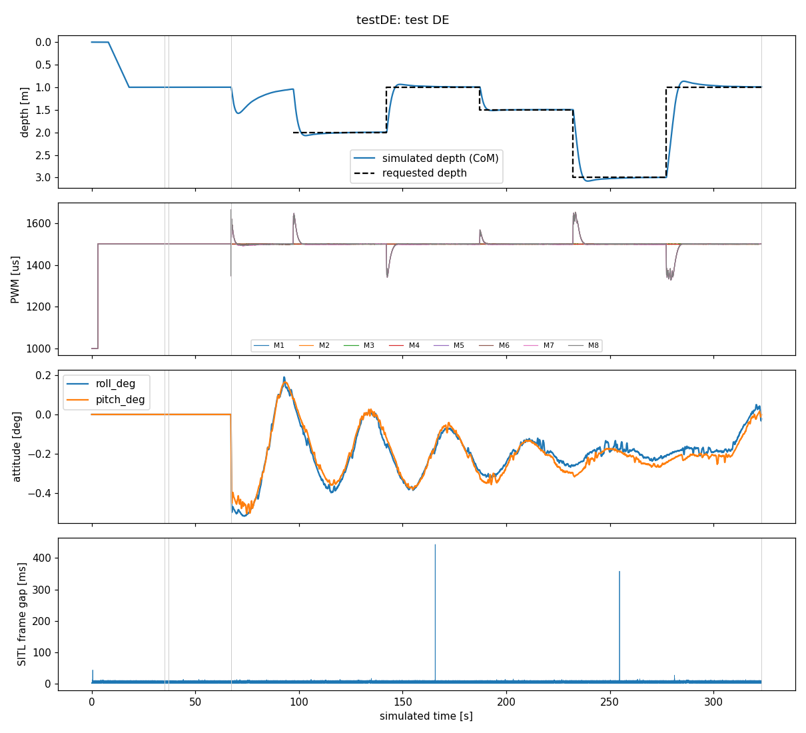
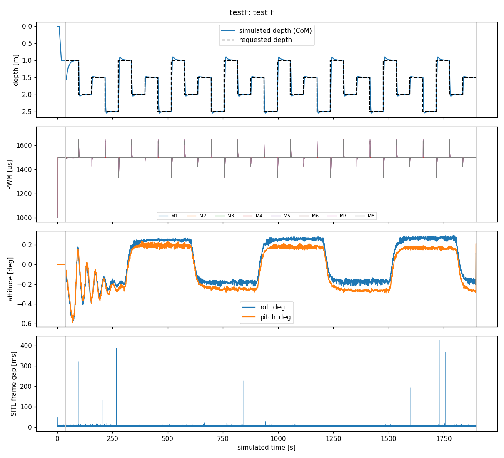

# Phase 2 — Minimal HoloOcean ↔ ArduSub SITL connection

**Status (2026-11-12): implemented and tested on a development PC.** ArduSub 4.1.2
SITL (the firmware version of the laboratory vehicle) commands a simulated
eight-thruster BlueROV2 in HoloOcean 2.3.0 in lockstep, and controls its depth.
Test results are in [§6](#6-test-results): A, B, C, D1, E and F pass; sub-test D2
(ALT_HOLD entry transient) does not meet its criterion, for a cause traced to
ArduSub 4.1.2 and not to the link. Nothing in this phase touched the real vehicle.

How to repeat everything: [REPRODUCE.md](REPRODUCE.md). Curated evidence:
[evidence/](evidence/).

This document separates **verified** facts (measured or read in the source of
the exact versions used), **design decisions**, and **assumptions / open items**.

## 1. Architecture actually implemented

```
 MAVLink client (tests)          ArduSub 4.1.2 SITL                bridge (Python)                    HoloOcean 2.3.0
 scripts/sitl_mission.py  TCP   build/sitl/bin/ardusub   UDP     src/bluerov2_sim2real/      shm    BlueROV2 agent,
 127.0.0.1:5830  <-------------> JSON backend ------------------> bridge.py: 1 step/frame  <------> control scheme 0
                                 servo pkt (16 PWM) 127.0.0.1:9072  thrusters.py: PWM->wrench        (8 forces, N)
                                 <------------------ JSON state     backends.py: drag comp.,
                                   (t, gyro, accel, pos, quat, vel)  sensors -> NED/FRD
```

* **Lockstep**: SITL sends one servo packet per control frame and blocks until
  the reply; the bridge advances HoloOcean by exactly one tick (dt = 5 ms) per
  *new* frame and answers with the state at t = k·dt. SITL advances its clock
  by the timestamp difference, so autopilot time and physics time are the same
  clock. Wall time is only measured.
* **Rate**: 200 Hz physics = `SCHED_LOOP_RATE` 200, as on the vehicle.
* **One HoloOcean instance per run**, in the lightweight `SimpleUnderwater` world,
  no viewport.
* Code: `sitl_json.py` (protocol), `frames.py`, `thrusters.py` (mixing, geometry,
  allocation), `drag.py`, `backends.py` (HoloOcean and mock), `bridge.py`.
  42 unit tests (`tests/`), no simulator needed.

## 2. Software, builds and the HoloOcean physics

| Item | Verified finding |
|---|---|
| Installed HoloOcean | client 2.3.0 (`49e70552`), official **Linux** `Ocean` package 2.3.0, engine SHA-256 `077983e4…28b5`. Stock build. |
| Build with the drag fix | exists only as a **Windows** package (separate engine-build project); there is no Unreal Engine on the Linux workstation to rebuild it. The fix is one line: `DragForce *= UEUnitsPerMeter` in `HolodeckBuoyantAgent.cpp`. |
| Drag in the installed binary | quadratic `−½ρ·Cd·A·|v|v` (ρ 997, Cd 0.8, A 0.45 m², isotropic, at the CoM) applied with a unit error: measured **0.0099–0.0100** of the intended value (`scripts/characterize_holoocean.py`). In addition Unreal applies `SetLinearDamping(1.0)` and `SetAngularDamping(0.75)` (measured linear term 1.00 s⁻¹). No rotational hydrodynamic drag, no added mass, no thruster dynamics in any build. |
| Decision | the bridge **adds the missing 0.99 of the quadratic drag** as a force at the CoM through the thruster allocation (`drag.py`). Equivalent to the corrected engine by construction (same velocity, point, sign and tick timing — argued from the source and checked by unit tests; no corrected Linux binary exists to compare against). Not a validated BlueROV2 drag model (Cd·A = 0.36 m² in every axis is larger than published BlueROV2 values). |
| Time step | the engine uses a fixed `DeltaTime = 1/ticks_per_sec` (`FixupDeltaSeconds`), independent of wall time; physics step = dt for tps ≥ 30 (UE `MaxPhysicsDeltaTime` 1/30 s). Verified at 30/100/200 Hz. |
| Cost per tick (no viewport) | median 0.62 ms, p99 1.3–1.6 ms at 30–200 Hz → up to 7.3× real time at 200 Hz. Rare stalls of 50–440 ms occur inside the engine tick; in lockstep they only delay wall time (SITL resends after 1 s; never reached). |
| Ports | HoloOcean on Linux uses **no network ports** (POSIX shared memory, random UUID per instance). |
| ArduSub SITL | built natively from tag `ArduSub-4.1.2` (`2dd0bb7d`, same as the vehicle) with gcc 13.3; Docker and WSL2 not needed. |

The 4.1.2 JSON backend was read in source and checked at runtime:
16-channel `<HHI16H>` packet (magic 18458); reply = one compact line
(`"key":value`, the parser reads values two characters after the key);
mandatory timestamp, `imu.gyro`, `imu.accel_body`, `position`, `velocity` and
`quaternion` or `attitude`; resend after ~1 s without reply; decreasing
timestamp = reset.

## 3. Conversions (verified)

| Quantity | HoloOcean | Sent to SITL |
|---|---|---|
| Frames | world NWU, body FLU (m) | earth NED, body FRD: `T = diag(1,−1,−1)`, `R_NED←FRD = T R T` |
| Position | PoseSensor at COM socket | NED from the start point; **z = depth below the surface** (SurfaceLevel 0) |
| Attitude | PoseSensor rotation | quaternion (w,x,y,z), body→earth |
| Velocity | DynamicsSensor at the CoM | NED |
| Angular rate | IMUSensor on `IMUSocket` (FRD) | rad/s, FRD |
| Specific force | DynamicsSensor CoM acceleration | `T Rᵀ(a − g)`, g = 9.8 (engine); ≈ (0,0,−9.8) at rest |
| Time | tick count | `timestamp = k·dt` |

Depth sensor: SITL synthesises the pressure itself from `position.z` (sea water,
1024 kg/m³, g 9.80665) and ArduSub converts with `9800·BARO_SPEC_GRAV`. Without
correction ArduSub read **2.47 %** deeper than simulated; SITL also added
±0.2 m uniform noise and truncated depth to 1 cm. Fixed (simulation only):
`BARO_SPEC_GRAV 1.0247`, `SIM_BARO_RND/SIM_BAR2_RND 0.005` (±5 mm, σ≈3 mm like
the real sensor), full-precision altitude in the SITL patch. Result (final D/E run, 2531 samples of `GLOBAL_POSITION_INT` at
10 Hz): ArduSub's depth estimate minus simulated depth = +4 mm on average, 95 %
within 1.1 cm including transients.

## 4. Thrusters: mapping, geometry, PWM → thrust

**Two layouts are deliberately kept apart.**

1. **Logical simulated vehicle** (what ArduSub commands): `VECTORED_6DOF`
   motors 1–8 on outputs 1–8, mixing factors copied from `AP_Motors6DOF.cpp`
   (4.1.2); horizontal thrusters at **30°** from the surge axis (verified angle
   on the real vehicle; measuring it from the surge axis is an interpretation
   to confirm), verticals vertical. Positive command = force that makes each
   motor's contribution match the sign of its mixing factors, with
   `MOT_n_DIRECTION = 1`. Lever arms provisionally reuse the HoloOcean positions.
2. **HoloOcean agent** (compiled in the engine): verticals 0–3, horizontals 4–7
   at **45°**, each force clamped to ±28.75 N.

Because the agent cannot be set to 30° without rebuilding the engine, the bridge
computes the 6-DoF body wrench of the logical vehicle and allocates it to the
agent: exact (rank 6) and anchored on the per-index mapping below, so the
verticals stay one-to-one; under saturation it redistributes along each group's
null space and, if still needed, scales the group (wrench direction preserved).

| ArduSub motor / output | Position (logical) | HoloOcean index at that position | Positive command | Verified in SITL (Test C) |
|---|---|---|---|---|
| 1 | front starboard, horizontal | 4 | backward-starboard at 30° (forward factor −1) | channel 1 only, direction cos 0.997, yaw sign ✔ |
| 2 | front port, horizontal | 5 | backward-port | ✔ |
| 3 | rear starboard, horizontal | 7 | forward-starboard | ✔ |
| 4 | rear port, horizontal | 6 | forward-port | ✔ |
| 5 | front starboard, vertical | 0 | down (throttle factor −1) | channel 5 only, depth ↑, roll + pitch − ✔ |
| 6 | front port, vertical | 1 | down | ✔ |
| 7 | rear starboard, vertical | 3 | down | ✔ |
| 8 | rear port, vertical | 2 | down | ✔ |

This is the **logical** correspondence of the simulation. It does **not** tell
which physical thruster is wired to which Navigator output, the propeller
handedness or the real thrust direction: on the vehicle `MOT_1,2,5,8_DIRECTION
= −1` compensates propeller handedness and the wiring is still to be verified
(Phase 1 open items). The SITL parameter set must never be loaded on the vehicle.

**PWM → command → thrust** (provisional, uncalibrated): `u = (PWM − 1500)/400`
(ArduSub 4.1.2 `calc_thrust_to_pwm` is linear), neutral 1500 µs, saturation at
1100/1900 µs; PWM outside 1100–1900 (e.g. the 1000 µs SITL emits before the
motors are enabled) = unpowered. Thrust = u·28.75 N forward, u·22.32 N reverse:
the T200 16 V forward/reverse ratio (51.4/39.9 N) scaled to the engine clamp,
so the bridge never assumes forces the engine silently clips (in the first
depth run with the unscaled T200 values 25 % of steps saturated). Authority is
therefore ~0.56 of a real T200 at full command; no dead band.

## 5. SITL parameters

[`configs/sitl/phase2_ardusub412.parm`](../../configs/sitl/phase2_ardusub412.parm)
is loaded on top of ArduPilot's `sub.parm`; every value is checked at run time
against the parameters reported by SITL (`mission/params.json`). Main points:
`FRAME_CONFIG 2` (SITL default is the 6-thruster frame), motors on outputs 1–8
(`sub.parm` maps output 8 to the camera tilt), `SCHED_LOOP_RATE 200`, no GPS,
one IMU/EKF3 lane, `SYSID_THISMAV 17`, the depth-sensor settings of §3 and the
**controller gains of the laboratory vehicle** (PSC_*, ATC_*, PILOT_*, THR_DZ,
INS filters, from the 2026-10-05 backup in the Phase 1 inventory). With the
`sub.parm` gains (≈4× more aggressive in the vertical loop) the simulated
vehicle entered a 3.5 Hz limit cycle. `PSC_ACCZ_FF` is not recorded for the
vehicle; the firmware default (0) is used.

## 6. Test results

Final runs on commit `8ddc796` (2026-11-12), each with its manifest. Criteria
for E were fixed before the final runs.

| Test | What | Result | Evidence |
|---|---|---|---|
| A — SITL environment | ArduSub 4.1.2 SITL builds and starts reproducibly; JSON fields accepted; EKF3 initialises; arms | **PASS** | `sitl.log` ("JSON received: timestamp, imu: gyro, imu: accel_body, position, quaternion, velocity"); all 65 overlay parameters confirmed in `params.json` (1264 parameters) |
| B — Protocol (mock) | full SITL loop with a mock rigid body; resends, losses, resets, foreign senders, malformed packets, slow steps | **PASS** | unit tests (42 passed); mock run: 19 635 frames, 0 lost, 0 duplicates |
| C — Thrusters | `MAV_CMD_DO_MOTOR_TEST` on each motor: only that output active, response direction and rotation signs as expected; MANUAL pilot axes x/y/z/yaw in the right sense | **PASS** (16/16) | [evidence/testC](evidence/testC/) |
| D1 — Initial stability, link | armed, MANUAL, neutral outputs for 30 s from the released state (1.0 m, at rest) | **PASS** — 0.000 m drift, 0.0° attitude change | [evidence/testDE](evidence/testDE/) |
| D2 — Initial stability, controller | ALT_HOLD engaged at 1.0 m, no target, 30 s | **FAIL** vs. criterion (≤ 0.10 m): **0.58 m** descent, back to +0.04 m after 30 s, attitude ≤ 0.52° | see §7, item 9 |
| E — Depth control | ALT_HOLD steps 1→2→1→1.5→3→1 m (45 s each) | **PASS** (5/5): settling 2.9–11.8 s (band max(5 cm, 5 %)), overshoot ≤ 0.13 m, final error ≤ 1.0 cm, roll/pitch ≤ 0.4°, 0 % saturation | [evidence/testDE](evidence/testDE/) |
| F — 30-min stability | ALT_HOLD cycling 1/2/1.5/2.5 m every 60 s for 31 min | **PASS** — see below | [evidence/testF](evidence/testF/) |

Depth control (Test E): requested vs simulated depth, PWM of the eight motors,
attitude, SITL frame gaps:



### Test F — continuous run (31 min)

| Metric | Result |
|---|---|
| Duration | 1860.0 s simulated, 1861.7 s wall; 379 415 physics steps |
| Communication | 0 lost frames, 0 resends, 0 stale resends, 0 SITL resets, 0 malformed packets, 0 receive timeouts |
| Simulated time step | exactly 5.000 ms for every frame; `frame_count` always +1 |
| SITL ↔ physics synchronisation | 14 176 / 14 176 PWM transitions in `SERVO_OUTPUT_RAW` (SITL time) match the bridge log at a constant +1 frame for the whole run: **no drift** (the preliminary run before the clock patch drifted +2 → +3 frames, see §7 item 10) |
| Frame interval (wall) | mean 5.005 ms, std 3.3 ms, p99 10.2 ms, p99.9 10.4 ms; 10 gaps > 50 ms (max 426 ms), all inside the HoloOcean engine tick (`step_ms` max 425 ms) |
| Simulated / wall time | 0.9991 overall, 0.990–1.000 per minute; simulated time ends 1.68 s behind wall time, entirely explained by the engine stalls above (lockstep keeps autopilot and physics on the same clock) |
| Depth control during the run | 31 holds; mean error over the last 10 s of each hold ≤ 6 mm (no trend between first and last holds); roll/pitch ≤ 0.59° |
| Saturation | 0 steps |
| Resources (bridge + engine) | ~1.1 CPU cores (mean 110 %, max 119 %); RAM 1298 → 1357 MB (+59 MB over 31 min, slow growth, not investigated); machine-wide GPU 0–49 % utilisation, 1.9–4.5 GB (includes another project's engine) |

The acceptance criterion of the plan — continuous operation for at least 30
minutes without unexplained loss of synchronisation — is met.



## 7. Problems found and fixes

1. Default SITL frame is 6-thruster and `sub.parm` assigns output 8 to the camera → explicit `FRAME_CONFIG 2` and `SERVO1..8_FUNCTION`.
2. Standard JSON (`": "`) is rejected by the 4.1.2 parser → compact encoder, tested against a re-implementation of the parser.
3. HoloOcean horizontals at 45° vs. vehicle 30° → wrench allocation (§4).
4. Stock drag 0.01 of intended → bridge-side compensation (§2).
5. T200 thrust above the 28.75 N engine clamp → hidden saturation → T200 curve scaled to the clamp.
6. SITL depth: sea-water model (2.47 % error), ±0.2 m noise, 1 cm truncation → `BARO_SPEC_GRAV`, `SIM_BARO_RND`, SITL patch.
7. `sub.parm` vertical gains → 3.5 Hz limit cycle → vehicle gains.
8. `MAV_CMD_DO_MOTOR_TEST` param1 is the **0-based output index** in 4.1.2 (sending 1 drove output 2), and the MAVLink `MOTOR_TEST_ORDER_BOARD` value is 2 → fixed in the client. A reminder that indices and channels must be verified, not assumed.
9. **ALT_HOLD entry transient (D2, not fixed: autopilot behaviour)**. In 4.1.2 MANUAL drives the motors directly and leaves `attitude_control.throttle_in` at 0; `AC_PosControl::init_z_controller()` then initialises the vertical-acceleration integrator to `(0 − 0.5)·1000`, clipped to `−PSC_ACCZ_IMAX` = −100, i.e. throttle 0.4 → command −0.2 → **≈1580 µs downward** on the verticals (observed 1585 µs 0.5 s after entry). With the vehicle's low `PSC_ACCZ_I` (0.1) it unwinds slowly. The same parameters on the vehicle should produce the same transient (to be checked in water); it is not caused by the link.
10. SITL clock truncation (`time_now_us += deltat·1e6`) lost one 5 ms frame every ~15–20 min against physics (observed in the preliminary 31-min run: offset +2 → +3 frames) → SITL patch rounds the increment.
11. SITL sockets listened on 0.0.0.0 on a shared university machine (MAVLink, RC in, and the JSON socket, which accepts sensor data from any sender) → loopback-only patch.
12. A resend received while a slow physics step is in progress would have been answered twice, leaving a permanent extra frame of latency → stale resends dropped using kernel timestamps.
13. Orchestration: orphaned engines on SIGTERM, port checks reading the wrong column, a race that left an orphaned SITL, no exclusivity → orderly shutdown, own-process-only cleanup, lock, engine count check (§8 of REPRODUCE).
14. Reproducibility: runs now record repository commit/diff, binary and parameter hashes, effective parameters; dirty trees are refused.

## 8. Independent reviews

Three reviewers examined code, sources and run data without being given the
expected conclusions (2026-11-12):

* **ArduSub/SITL** — protocol, quaternion convention, mixing table, motor-test
  indexing and lockstep confirmed correct against the 4.1.2 source and the
  run data. Raised: 1 cm baro truncation, duplicate-reply latency hazard, boot
  PWM 1000 → reverse, overlay gaps (PSC_ACCZ_FF, IMU/EKF lanes, GPS, gains),
  tests that could not fail, JSON socket on 0.0.0.0, clock truncation, SITL
  restart handling. **All addressed** (items 6, 10–12 above; Test D split into
  D1/D2; criteria tightened; overlay extended), except the vehicle values of
  `PSC_ACCZ_FF` and other unrecorded parameters (open).
* **HoloOcean/physics** — geometry transcription, moments about the CoM,
  frames, quaternion, drag compensation equivalence and 200 Hz stability
  confirmed. Raised: element-wise clipping distorting the wrench, IMU socket
  lever arm (~0.12 m), held-state velocity, boot PWM, submerged fraction near
  the surface, very high yaw rates. **Addressed**: null-space/group-scaling
  saturation, specific force at the CoM, consistent hold and release at 1 m;
  yaw rates explained as a model property (no rotational damping, Izz ≈ 0.42
  kg·m² from the data) and left for Phase 4.
* **Software/reproducibility/safety** — loopback-only listeners, real-vehicle
  interlocks and public-repo content confirmed. Raised: orphaned engines on
  SIGTERM, untraceable runs, missing reproduction guide and lock file, port
  races, no two-instance enforcement, weak tests, statements of assumptions as
  facts. **All addressed** and the D/E/F tests re-run on the committed code.
* **Final verification** (a fourth independent reviewer, after the fixes):
  all 14 previously raised issues fixed in the committed code; final runs
  traceable to clean commit `8ddc796` and to the patched SITL binary (hashes
  match); **no blocking issue**; eight low-severity hardening items, listed
  in §10.

## 9. Ports and processes used

SITL instance 7: TCP 127.0.0.1:5830/5832/5833, UDP 127.0.0.1:5571, JSON socket
127.0.0.1 (ephemeral) → bridge UDP 127.0.0.1:9072. One HoloOcean engine per
run (`Holodeck SimpleUnderwater …`). Our processes (bridge + engine) used
~1.1 CPU cores and 1.3 GB RAM in the D/E run; machine-wide GPU memory was
3.6 GB on the RTX 6000 with another project's engine running (per-run
`resources.csv`). Another project's HoloOcean instance
(`PierHarbor`) was running on the machine during part of the work and was
never touched; at most two engines ran at any time.

## 10. Open items (carried forward)

* Physical thruster ↔ output wiring, propeller handedness, thrust signs and
  lever arms of the real vehicle; interpretation of the 30° angle.
* Thrust curve (dead band, nonlinearity, voltage), thruster dynamics; real
  T200 authority (engine clamp 28.75 N); added mass, rotational damping,
  realistic drag coefficients, real mass/CG/CB/buoyancy (HoloOcean BlueROV2 is
  exactly neutral, 11.5 kg) — Phase 4.
* Vehicle values of parameters not recorded in Phase 1 (e.g. `PSC_ACCZ_FF`);
  check the ALT_HOLD entry transient on the vehicle.
* Test F shows step-like changes of the simulated roll/pitch of about ±0.25°
  at irregular intervals of a few minutes, unrelated to the depth cycle
  (visible in the Test F plot). Amplitude < 0.6°, not investigated; a change
  of ArduSub's attitude reference (EKF) is a hypothesis, not a finding.
* RAM of bridge + engine grew by 59 MB over 31 min; not investigated.
* Hardening items from the final verification, not blocking: the SITL patch
  only prints a message (does not abort) if binding the JSON socket to
  loopback fails; the bridge locks onto the first loopback sender without
  checking that it is the SITL process; a stale reply is still possible if a
  reply arrives just after SITL's 1 s timeout and before its resend (needs a
  ~1 s engine stall; never observed); `summary.json` shows
  `stop_reason: interrupted` for every orchestrated run because the
  orchestrator always stops the bridge with SIGTERM — use
  `run_manifest.txt: mission_exit_code` to tell normal from abnormal ends.
* After the final runs (commit `8ddc796`) only orchestration/logging
  hardening and documentation changed (longer orderly-stop timeout, warning
  when kernel timestamps are missing, untracked files counted as dirty); the
  bridge's numerical path is unchanged.
* A corrected HoloOcean Linux build would remove the bridge-side drag
  compensation (requires Unreal Engine 5 and an Epic-linked GitHub account).
* SITL ↔ BlueOS / Raspberry Pi execution, common autonomy interface — Phase 3.
